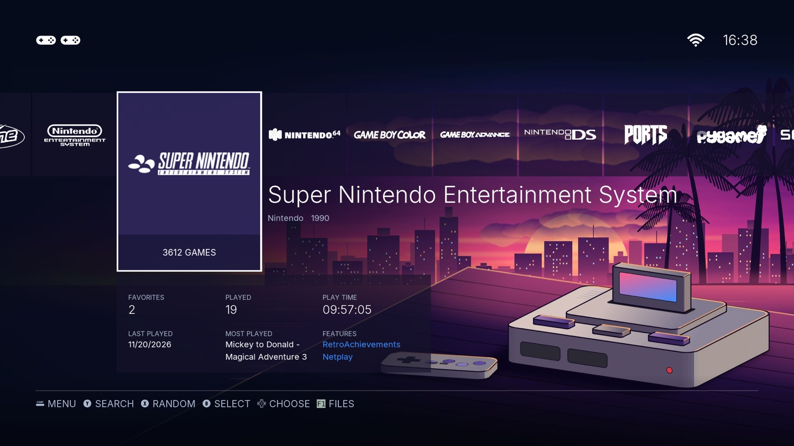
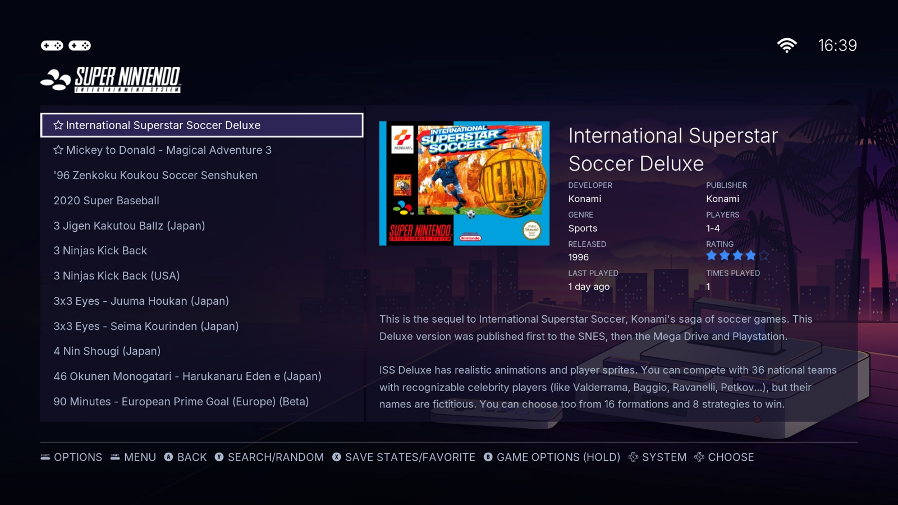
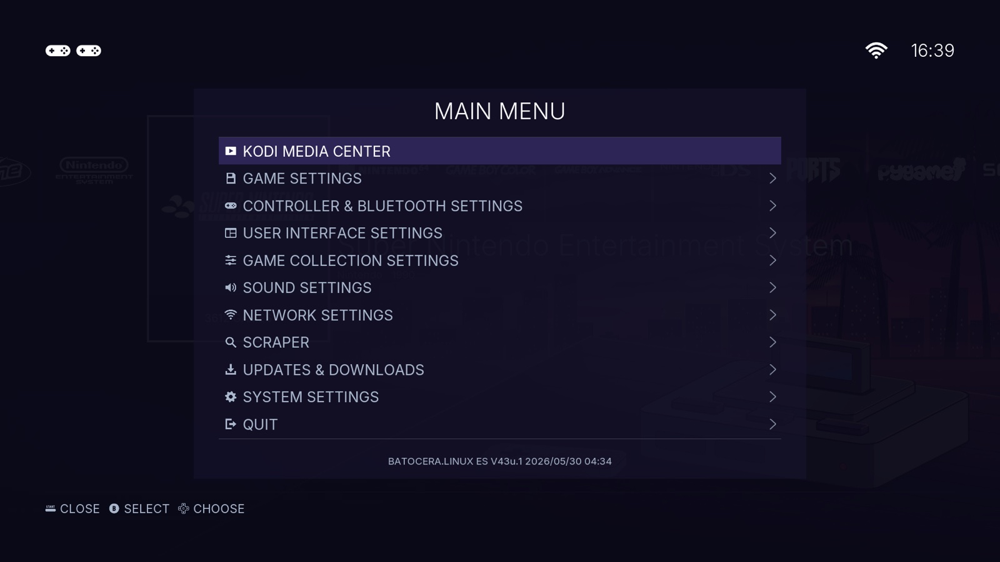
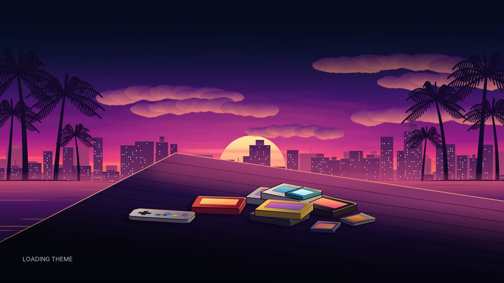

# batox-theme

A dark EmulationStation theme for [Batocera](https://batocera.org), in the style of a modern
console's home screen: flat dark tiles over a picture of each system at sunset, white type, and
one thin white frame on what is selected.



| The game list | The menus | Loading |
|---|---|---|
|  |  |  |

## What you get

- **Home.** One row of square tiles with each system's logo in white. The selected system grows
  into a card with its number of games; its name, maker and year sit beside it, and a panel with
  your favorites, games played, play time, last day played and most played game fades in after
  a second.
- **A picture per system.** Every system of Batocera has its own background, drawn for this
  theme: the machine on a pier in front of a coastal city at sunset. The best-known consoles,
  handhelds and computers have a drawing of their own; the others share one with their family
  (an arcade cabinet, a home computer, a handheld), in their own colors; collections get a neon
  sign.
- **Game list.** The games in a list at the left; at the right the selected game's cover, name,
  developer, publisher, genre, players, year, rating, last time played and description. A game
  with a video plays it in the cover's place after a few seconds.
- **Menus.** EmulationStation's menus as a panel in the middle of a darkened screen, with the
  theme's own white icons.
- **Loading screen.** While EmulationStation starts: a picture of its own, and the bottom line
  filling as the systems load.
- **Top bar.** The connected controllers (lit while in use), your RetroAchievements avatar and
  name when an account is set up in Batocera, the network and the clock.
- **English and Brazilian Portuguese**, following the console's language.

## Requirements

- Batocera 43 or newer (made and tested on 43.1, on a Raspberry Pi 4).
- A 16:9 screen, 1080p or 720p. Smaller and 4:3 screens are not tuned yet.
- Batocera's default theme, Carbon, left installed (it always is): the systems' logos are read
  from it.

## Install

1. Download `batox-theme.zip` from the
   [latest release](https://github.com/monteirohat/batox-theme/releases/latest).
2. Unpack it into `/userdata/themes` on the console (the `share/themes` folder over the
   network), so the theme is at `/userdata/themes/batox-theme`. With
   [BatoX](https://github.com/monteirohat/batox), install the ZIP from its EmulationStation
   screen instead.
3. On the console: Main menu > User interface settings > Theme set > batox-theme.

To update, replace the folder with the new release's.

## Options

In Main menu > User interface settings > Theme configuration:

| Option | Choices |
|---|---|
| Accent color | blue (default), purple, teal, red, gray |

The accent colors the few words the theme highlights: a game's rating, and what a system
supports.

## Good to know

- **Gamelist view style**: leave it on automatic. The list described above is the theme's view;
  the grid and carousel styles are not themed.
- **A machine drawn wrong, or too generic?** Many systems share a family's drawing; tell which
  one deserves its own. A few system logos that don't turn white cleanly are also still to do:
  see [docs/ARCHITECTURE.md](docs/ARCHITECTURE.md#per-system-artwork).
- **Size**: about 36 MB, nearly all of it the systems' pictures.
- **Batocera's own image** still shows as the console boots and, on a Raspberry Pi, while a
  game starts: it belongs to the system, not to a theme.
- **Notifications** appear at the top center: their place belongs to EmulationStation.

Found a problem, or want a system drawn? Open an
[issue](https://github.com/monteirohat/batox-theme/issues).

## Development

```bash
python3 tools/check.py                      # checks XML, includes, files, elements, variables, sizes
python3 tools/render-system-backgrounds.py  # draws systems/*/background.jpg (needs Chrome)
python3 tools/render-icons.py               # draws the theme's icons
python3 tools/render-frames.py              # draws the selector, the buttons' outline, the menus' page
python3 tools/render-background.py          # draws _inc/backgrounds/waves.png
CONSOLE=batocera.local tools/deploy.sh      # copies the theme to a console over SSH
tools/package.sh                            # builds dist/batox-theme.zip from the last commit
```

- [docs/STYLE.md](docs/STYLE.md): how every screen should look, and why. Read it before
  changing one.
- [docs/ARCHITECTURE.md](docs/ARCHITECTURE.md): how the theme is built, its design tokens, and
  what was learned about the engine.
- [docs/PUBLISHING.md](docs/PUBLISHING.md): how a version is released, and how Batocera lists
  themes.
- [CHANGELOG.md](CHANGELOG.md): what changed in each version.

## Credits and trademarks

Everything the theme ships is its own, drawn by its tools: the systems' pictures, the icons, the
frames and the wave background. Its font is Inter (SIL Open Font License).

The systems' logos are those of Batocera's default
theme, Carbon (CC BY-NC-SA, by Fabrice Caruso and its contributors). The theme reads them where
Batocera installs them and ships none; it only draws the logos in white.

The theme takes inspiration from console home screens and from the mood of sunset city art, but
uses none of their assets. It is not affiliated with any console maker or game publisher, nor
with the Batocera project. System names and logos are trademarks of their owners.

## License

[MIT](LICENSE), except the Inter font, which keeps its own license (SIL Open Font License 1.1,
[_inc/fonts/Inter-LICENSE.txt](_inc/fonts/Inter-LICENSE.txt)).
